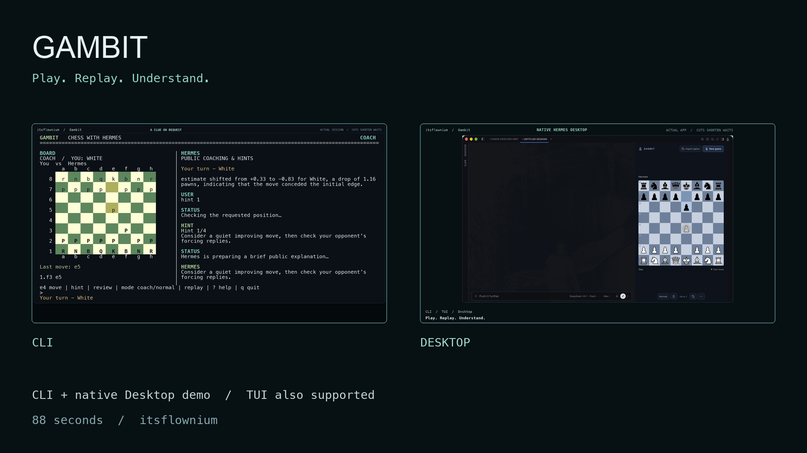

# Gambit for Hermes

Play a game. Understand a move. Revisit your own matches.

Gambit brings chess to Hermes terminals and Desktop. Run `hermes gambit` for a standalone terminal board, use `/chess` for text-board output in a Hermes CLI or TUI conversation, or open the optional graphical pane in Hermes Desktop. Play against Hermes, request hints, and replay or practice public Chess.com and Lichess matches.

Version 0.3.0 supports the standalone terminal board, ordinary CLI chat tools, the native Hermes TUI and the optional Desktop pane. Production checks cover model-backed play/coaching and the real CLI/TUI command flow. The CLI/Desktop film and anonymous public-source admission checks pass. The exact catalogue pin is recorded in the catalogue PR, which is ready for review. See the [verification report](docs/verification.md). The catalogue scope remains macOS only.

## Demo

[](demo/Gambit-Demo-Review.mp4)

[Watch the 88-second CLI and Desktop demo](demo/Gambit-Demo-Review.mp4). It shows real terminal dashboard play, requested hints, coaching, a quiet Normal turn, exact public-match import and replay practice, followed by a genuine turn in the native Hermes Desktop app. The [demo folder](demo/README.md) includes 18 English caption cues, nine chapter controls, a poster and the verified review player. Timing cuts and the linked-development capture's source-pin limit are disclosed in [the capture provenance](demo/source-provenance.json); the original main CLI take's exact in-memory source snapshot was not frozen.

The CLI launch prompt uses the public alias `itsflownium`. The native Desktop host/device status strip is cropped for privacy, and the alias appears in added chrome throughout. The full film and its accompanying media have been checked for personal names and local paths. TUI remains a supported feature.

## Start

### Standalone terminal board

After installation, open an interactive macOS terminal and run:

```sh
hermes gambit
```

The curses dashboard is a separate terminal application with its own Gambit session. It uses the active Hermes profile's plugin data and configured provider; it does not attach itself to whichever Hermes chat happens to be visible. Hermes Desktop is optional.

Run `hermes gambit --help` for options. `--colour white|black`, `--strength learning|balanced|strong` and `--mode coach|normal` choose a new game's settings; `--ascii` uses ASCII pieces. `--session` resumes a saved standalone `terminal:<32-hex>` session in the active profile. Launch requires an interactive terminal; non-TTY invocation exits with a usage error. With `plugins.isolation: host`, Hermes skips standalone CLI command registration; use `/chess` in a Hermes conversation instead.

### Hermes CLI or TUI conversation

Initialize chess in your current conversation:

```text
/chess
```

Bare `/chess` starts a White, Balanced, Coach game when none is selected, or refreshes the current board. `/chess` and `/chess play` return the same text board across Hermes chat surfaces. Continue in your CLI or TUI conversation with ordinary chess requests. Each conversation keeps its own game; no dedicated chess profile is required. A CLI/TUI move tool waits for one opponent reply and returns the completed board. In Coach mode, Hermes uses the exact move-review evidence for brief feedback before showing that board.

Shortcuts such as `/chess move e4`, `/chess hint 2` and `/chess next` return board output or local engine evidence directly. Use ordinary conversation when you want a model explanation. Text output updates on a command or chat turn.

Then use ordinary conversation:

```text
Play against me. I'll play White in Coach mode.
Start a normal game against me, without automatic coaching.
My Chess.com username is USERNAME. Find my recent matches.
My Lichess username is USERNAME. Replay my latest completed game.
Explain my last move.
Give me a hint.
Give me a stronger hint.
Show my saved matches.
Export this match as PGN.
```

### Optional Desktop pane

In Hermes Desktop, the knight button shows or hides a graphical board beside your existing chat. Choose **Play Hermes** or **Import game**. A fresh **Play Hermes** creates a normal chat automatically. The pane follows the chat on screen, including with **All profiles** selected, and keeps games separate. Graphical board actions run asynchronously while the pane updates; slash commands still return text directly. It adds no permanent sidebar entry or extra chat panel. Every graphical control has hover help.

### Play modes

**Coach:** Hermes plays against you and gives short feedback about your preceding move in the standalone dashboard's coaching pane, an ordinary CLI/TUI chat turn, or the bound Desktop chat. Slash shortcuts return direct board/evidence output; use ordinary chat for narration. You can ask for more detail.

**Normal:** Hermes plays against you without automatic commentary. Hints and explanations are available whenever you ask.

Change mode through chat or the controls for your board. Games are untimed standard chess, and moves accept SAN or UCI notation through chat. The Desktop pane also supports selecting a piece and destination or dragging it, all four promotion choices, undo, resignation, and legal draw claims. Its resignation animation shows GG and fireworks before starting a fresh game as White after three seconds. The resigned match stays saved.

Optional shortcuts:

```text
/chess play white normal
/chess play black coach learning
/chess chess.com USERNAME
/chess lichess USERNAME
/chess open 2
/chess move e4
/chess hint 2
/chess next
/chess status
```

### Replay

In the Desktop pane, click **Import game**, choose **Chess.com** or **Lichess**, enter a username, and search. Select a returned match to open its replay; each result shows the players, date, searched player's colour, and result. Hover for the exact game ID, or use **Older games** to browse further back. Search again to return to the newest matches.

You can also tell Hermes the platform and username, for example, “My Lichess username is Alice.” Hermes returns a numbered list. Reply “game 2” to select that exact match, or explicitly ask for “my latest match.” A username alone does not select a game. Each chat keeps its own search list and player perspective. Coaching and requested hints stay in chat.

The Desktop board's match strip shows the selected platform, username, opponent, date, and original result, with a link to the official game. It faces that player's side. **Move your pieces directly**, or click **Play from here**, to play through the match yourself. Through chat, ask to practice from the selected position. This creates a saved practice game; the original match remains intact, and its identity stays visible during practice.

When you follow the recorded moves, the opponent plays exactly its next recorded reply. If you try a different move, Hermes calculates one legal reply. You move once, the opponent replies once, and it is your turn again. **Back to recorded match** returns to the source. You can also use first/previous/watch/pause/next/last controls or ask Hermes to jump to a move.

Desktop guided playback waits for chat coaching on the selected player's moves. Its guided-control toggle allows replaying without automatic explanations. Forward and back refer to individual White or Black moves, so every position is accessible.

Only completed public standard-chess matches are imported. Public APIs can delay availability of a newly completed match. A username is a lookup, not an authenticated account connection. Source links and the original PGN are preserved.

**Search games** checks the selected platform's public archive. After a search, **Refresh games** checks the source again instead of reusing the plugin's saved result. Empty searches expire after 30 seconds, so a new account's first published game is not hidden behind an hour-long empty cache. If the source fails, Gambit shows the error; saved nonempty results remain available with a notice.

Chess.com may still return its own cached data; refreshing Gambit cannot force Chess.com to publish a newly finished game sooner. Its [public API documentation](https://support.chess.com/en/articles/9650547-what-is-the-pubapi-and-how-do-i-use-it) explains that delay. [Bot and Coach games are private](https://support.chess.com/en/articles/8609271-can-i-save-my-games-against-the-bots), so username search does not include them. Gambit is an independent plugin and is not affiliated with Chess.com or Lichess.

### Requested hints

Hints reveal progressively: a clue, the piece/source square, the destination, then the exact move and a legal continuation. Later levels are withheld until requested. A new position starts again at the first level. Normal mode supports the same hints as Coach mode.

## The move-time limit

The default move-response budget is **60 seconds**, with an enforced maximum of 60. Hermes's structured move-selection request gets at most 45 seconds within that budget. A separate deadline worker reserves time to commit a precomputed legal local-engine move if the model stalls. Late model results cannot add another move or change a newer position.

Moves can finish sooner; Gambit never sleeps just to stretch a fast answer to 30 seconds. The intended ordinary response range is around 30–60 seconds when the configured model needs that time. The UI shows the remaining move budget.

The deadline applies to the board reply, not the speed of the separate conversational coaching response. If the configured model is unavailable or times out, the board labels the reply as engine-assisted, and the coaching evidence records that fallback. A rare engine failure uses an explicitly labelled legal recovery reply to preserve the deadline.

New chat explanations need working access to the configured Hermes provider. If that provider rejects calls because access or credits are unavailable, board play can continue with its labelled local-engine fallback; conversational coaching resumes when provider access is available again.

## Calculation and coaching

Python-chess owns the legal game state. A local Stockfish process supplies move candidates, tactical lines, and position estimates. Hermes chooses among legal candidates and teaches from the calculation evidence through the user's configured model.

Opponent strength and full-strength review are separate. Learning, Balanced, and Strong are descriptive presets, not calibrated player ratings. Coaching does not invent accuracy scores or claim a position is checkmate merely because a source match ended by resignation or time forfeit.

Every accepted move is stored before any model request. Replay navigation cannot alter the original move sequence. Analysis, source PGN, results, and replay position survive restarts. PGN export includes saved review annotations.

Undo restores your turn, including after a final checkmating move. Coaching and saved annotations follow the retained move sequence: taking back a move removes its pending feedback, and a delayed analysis cannot attach to a different move or match.

For a full-game recap, ask in a Hermes conversation. The `chess_replay` summary tool may calculate in the background. Desktop can announce when it is ready; in CLI/TUI chat, request the recap again later. The standalone terminal dashboard supports move reviews and hints but has no full-match summary command.

## Install

Requires Hermes Agent **0.23.0 or later**, Python **3.11 or later**, and a local Stockfish executable. The standalone terminal dashboard needs an interactive terminal with Python's `curses` support. Hermes Desktop is required only for the graphical pane. The catalogue scope is **macOS**; Linux, Windows, and a second physical computer have not been verified. Python dependencies are declared with bounded versions in `pyproject.toml` and prepared by Hermes's package manager.

Install the repository through Hermes's supported installer:

```sh
hermes plugins install https://github.com/itsflownium/gambit-hackathon --yes-deps --enable
```

An unpacked source ZIP can use the linked-folder installation below; the Git-URL installer expects a committed Git checkout.

For linked local development, place a link to the checkout in the active Hermes home's `plugins/gambit` directory and run `hermes plugins enable gambit`. For the optional Desktop pane, also enable **Gambit Chess** in Capabilities → Plugins and rescan if needed. If dependencies were installed after the gateway started, restart the gateway through Hermes's normal restart command.

Download Stockfish from [its official site](https://stockfishchess.org/download/) and choose its executable in Gambit's plugin settings, or install it on your system PATH. Gambit also recognizes an executable at its profile-local `plugin-data/gambit/engine/stockfish` path. It never downloads or updates an engine in the background.

Local verification used Stockfish 19 from its official macOS archive, checked against SHA-256 `a1f0e3bcc5a6927a11fe6fc8e54a779754645f3c2bae2cf13420fd1957adaa77`. The engine binary is not included in this repository.

### Plugin settings

- `engine_path`: optional absolute executable path.
- `move_timeout_seconds`: default 60, always capped at 60.
- `analysis_seconds`: default 0.4 seconds for initial local analysis; significant errors get a deeper check.

Settings live under `plugins.entries.gambit.settings`. Global Hermes model and reasoning settings are left intact.

## Chat delivery and data

The `/chess` command and eight chess tools operate in their Hermes conversation. Ordinary CLI/TUI move tools wait for the single scheduled opponent reply, return a fixed-width board and carry an exact review request in Coach mode. Slash shortcuts provide deterministic board or engine evidence without autonomous model narration. The standalone terminal board keeps a separate Gambit session in the active profile. Its terminal presentation is not a widget embedded in Hermes's TUI.

In the optional Desktop pane, coaching is delivered through the native SDK's **session-addressed desktop composer**. It targets only the visible conversation bound to the board, waits while that conversation is busy, and acknowledges delivered events. If that chat is closed or another chat is selected, feedback waits for the correct chat to be visible again. No gateway message-injection permission is required.

Data is profile-local in Hermes's persistent `plugin-data/gambit` directory. Each selected match and replay cursor belongs to its conversation or standalone terminal session. Deleting a saved match removes its saved analysis and detaches its board from that session.

Network and process disclosure:

- Username searches request public game data from `api.chess.com` or `lichess.org` using documented APIs. No account passwords, browser cookies, private game chat, or scraping are used.
- Move selection and chat coaching use the user's existing Hermes model/provider. Normal provider usage applies. Chess positions and calculation evidence are supplied to that model.
- Stockfish runs locally as a bounded subprocess. The plugin uses small background threads for move deadlines and full-match reviews.
- No telemetry or separate hosted service is used.
- Imported text is treated as untrusted data, never executable instructions.

This independent plugin is not affiliated with or endorsed by Chess.com or Lichess. Its board colours, logo, and interface are its own. Open-source dependencies and piece-art attribution are described in `THIRD_PARTY.md`.

## Development and verification

Native source is in `src/`. Rebuild the standalone SDK entry after edits:

```sh
python3 scripts/build_ui.py
```

From a development environment with the declared dependencies and pytest:

```sh
python -m pytest tests -q
node tests/desktop_contract.mjs
hermes plugins doctor . --ci
hermes plugins validate . --install-deps
```

The optional `serve.py` previews only the graphical chessboard in a local browser. It does not provide the terminal dashboard or a Hermes conversation. Install the development extras, then run:

```sh
python serve.py --demo --engine /absolute/path/to/stockfish
```

The preview binds only to loopback. It does not simulate a Hermes chat or pretend that local engine responses are model responses.

The committed preview bundle can be rebuilt after board changes with `npm ci && npm run build` from `preview/`. Its dependencies and integrity hashes are locked. Hermes Desktop itself uses the host's React and needs no Node dependency installation.

## Release status

Version 0.3.0 adds the terminal board and `/chess` text presentation while retaining the optional Desktop pane. All **175 behavioral tests** pass. Production dashboard play/coaching, CLI tool flow, native TUI commands, Desktop contracts and dependency-aware candidate validation pass. A supported Git install into a fresh default Hermes home also passed actual terminal play, help and clean exit without Desktop or copied model credentials; its reply was labelled engine fallback. The 88-second CLI and native Desktop film passes decode, captions, chapter seek, desktop/mobile player and privacy checks. The anonymous public candidate passed dependency-aware admission and the current catalogue structure, payload, confinement and self-updater gates. The catalogue PR records its published pin. Earlier Desktop results are preserved as historical evidence.

The existing [upstream catalogue PR](https://github.com/NousResearch/hermes-agent/pull/152547) is ready for review and records the published source pin and media URLs. Social posting and the hackathon form are separate actions. See the [release checklist](docs/release-checklist.md) and [verification report](docs/verification.md).
