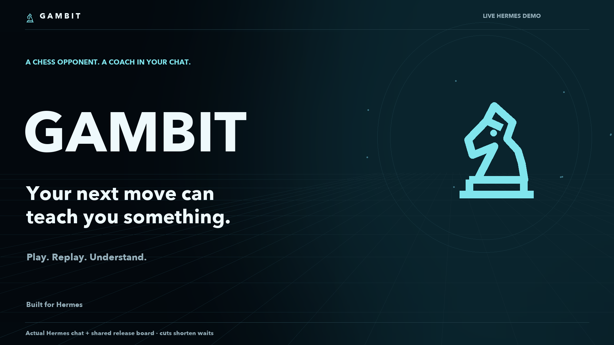

# Gambit live demo

[Watch the revised 89-second demo](Gambit-Demo-Review.mp4). Open `Review.html` for eight chapter controls and optional English captions. The MP4 is 1920×1080 at 30 fps, H.264/AAC with stereo 48 kHz audio.

## Fresh evidence

The deliberately short real game is `1. f3 e5 2. g4 Qh4#`. GPT-6 Sol, using the existing Hermes OAuth connection and xhigh reasoning, selected both replies from Stockfish-calculated legal candidates. They were stored as `origin=hermes`, taking 5.501 and 7.467 seconds. The film shows the actual pending-move indicator rather than private model reasoning.

Fresh chat turns called `chess_hint` and `chess_review`: a level-one clue, a level-two knight hint, and feedback explaining why `2.g4` permitted immediate mate and how `2.Nc3` would have avoided it. Normal mode completed `e4 → e5` with a model reply and no automatic coaching event.

The picker found completed public Chess.com match `186751169392` for `EmboldenedNeighbor`, showing opponent, date, result and Black perspective. Practice `...c5` received exactly the original `Nf3`; alternative `...e6` received a fresh model-selected `Nc3`. Both received real retrospective coaching. The imported original retained all 15 half-moves. Lichess is supported and was separately checked; this film's search uses Chess.com.

## Capture and editing

The unchanged release board runs in a public Hermes SDK workspace beside the real Hermes chat, bound to the actual plugin API. A local recording adapter handles that binding and coaching delivery. This is a live shared-board capture, not a fresh native toolbar-launch test. Chat replies are not recreated. Crops, stills, timing cuts and accelerated waiting periods make the results readable within 89 seconds.

The first 30 fps source capture overloaded the development Mac and two hint attempts timed out. After closing the disposable demo app and reducing capture to 10 fps, the requested hints succeeded. The final 30 fps film repeats source frames where needed. It is an edited demonstration, not a performance or reliability benchmark. The failed takes are excluded from the edited success sequence; the failure and correction are disclosed here.

Narration uses Kokoro v1.0's `af_heart` synthetic voice, through kokoro-onnx 0.6.1, with the original score *Quiet Continuation*. Music uses local additive synthesis without samples or external tracks. The closing recurring-mistake and targeted-practice ideas are explicitly unimplemented. See `audio-timings.json` for timing and provenance, and the repository's third-party notices for licensing.

Raw captures, credentials, runtime databases, model weights, engines and production helpers are excluded. Catalog submission, social posting and the organizer form remain separate actions.
