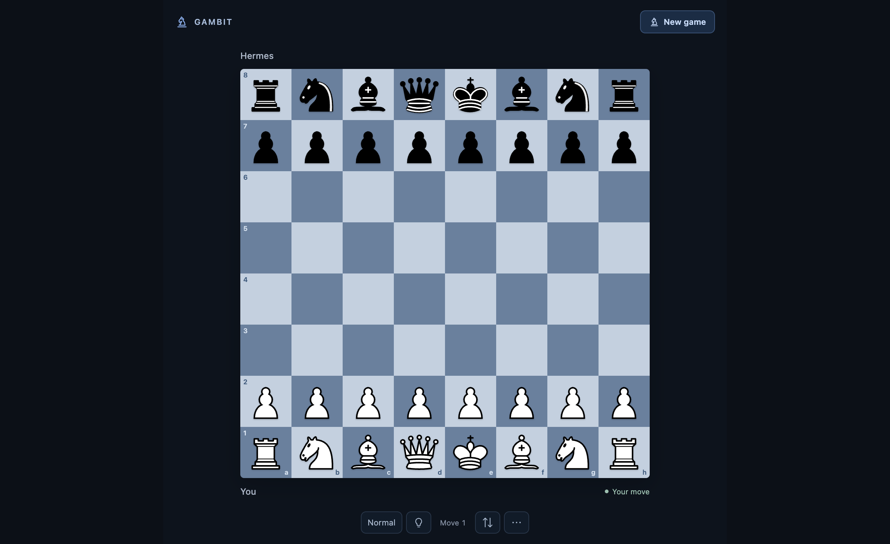
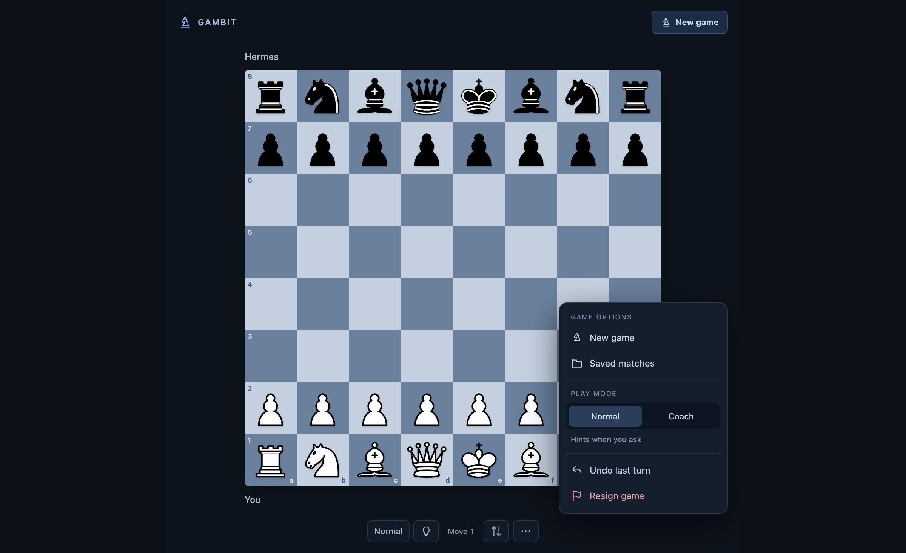
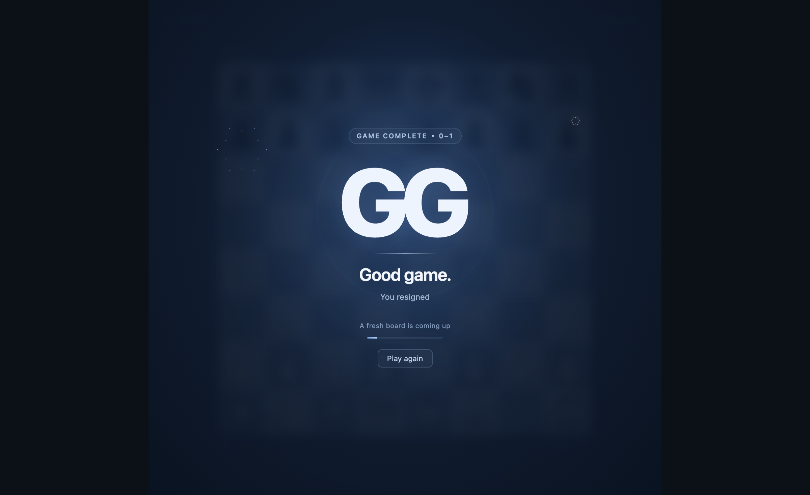
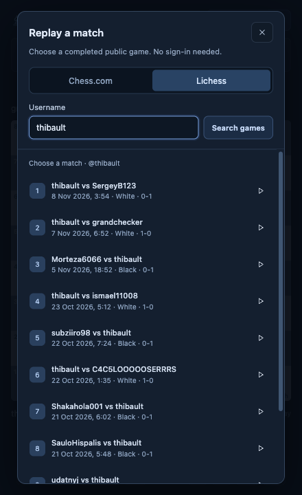
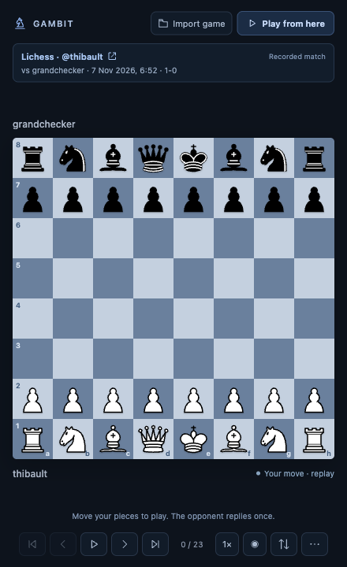

# Local verification — Gambit 0.3.0

Updated 2026-11-10 (AEDT). Version 0.3.0 has automated, real terminal, production CLI tool/coaching, native TUI, fresh-install and final media checks recorded below. Final immutable-pin publication and validation are pending. Historical Desktop results retain their original dates and versions. Repository verification is separate from catalogue acceptance and hackathon submission.

## Terminal release checks — 10 November

The candidate adds `hermes gambit`, a standalone curses board using a separate Gambit session, and `/chess` text-board output inside a Hermes CLI or TUI conversation. The graphical Desktop pane remains optional. The declared Hermes floor remains `>=0.23.0`, with macOS-only catalogue scope.

The sanitized [terminal acceptance summary](terminal-acceptance.json) records the test totals, actual host scope, timing observations, fresh-install fallback, Plugin Doctor, validator and final film fingerprint.

The final candidate run of `python -m pytest -q --tb=short` passed **175 behavioral tests** in 12.20 seconds, with two existing dependency deprecation warnings. It covers terminal commands and session isolation, position-bound coaching, deterministic slash actions, CLI/TUI tool output and reply waiting, engine recovery, portable bare/start slash commands on local, unknown and Desktop surfaces, legacy host-surface detection and coaching close races. Natural nonterminal tool policy and the graphical board's asynchronous transport have regression coverage. Python compilation, generated Desktop-entry syntax, Desktop contracts and whitespace checks also passed.

A real Unix pseudo-terminal integration check starts the actual curses renderer, accepts `e4`, stores exactly one fixture-engine `...e5`, shows the updated reply, survives a resize, displays help, quits cleanly and restores terminal echo/canonical input. That test uses a fixture engine and no live model; it is separate from the production check below.

The official profile-scoped command `hermes -p gambit-demo gambit --help` succeeds and displays the registered standalone command's options. It does not open a board or make a model request. The host reports an existing environment/lock synchronization notice; the help check is not a fresh dependency-aware validator pass.

The actual ASCII terminal dashboard completed `1.f3 e5 2.g4 Qh4#` using GPT-6.1 Sol through the existing host-managed OAuth provider route. Both opponent replies were stored with Hermes origin. Automatic feedback for `f3` and requested level-one/level-two hints returned genuine model prose. The first hint was a quiet-improvement clue; the second named the e2 pawn. A separate clean Normal take completed `1.e4 c5` with a Hermes-origin reply, no automatic feedback and `coach_queued=false`.

The terminal capture selected public Chess.com match `186751169392`, with 15 original half-moves and Black perspective. Following `...c5` received the recorded `Nf3`; trying `...e6` received a fresh Hermes-selected `d4`. Returning to the source preserved all original moves and its result. This is distinct from the older Desktop film's alternative continuation.

The main Coach/replay take used a supported linked local development install before the final source commit and later file copies; its exact in-memory bytes were not frozen. The separate clean Normal take launched after the core commit and source sync. The film is genuine recorded terminal operation, but it is not an immutable capture of the final release pin. [Source provenance](../demo/source-provenance.json) and the [edit timeline](../demo/edit-timeline.json) preserve those disclosures.

The final [terminal film](../demo/Gambit-Demo-Review.mp4) is **88.000 seconds**, 1920×1080, H.264 at 30 fps with 2,640 frames, and stereo 48 kHz AAC. Full decoding passed with no errors or warnings. It includes 18 English caption cues and nine external chapter controls. Actual browser playback and a seek to 68.040902 seconds passed; the caption band fits with playback controls visible on desktop and at a 375-pixel mobile width. Native fullscreen remains unverified because the headless QA browser denied it.

The [poster](../demo/poster.png) and [terminal screenshot](terminal-preview.png) use the real feedback frame at 42.75 seconds. Selected terminal text, encoded frames, public text and video metadata passed the recorded privacy checks. The MP4 SHA-256 is `0d3818034ae52e6ef95659e36643ebb3b7ba2157959678c379a3a248b0fed522`. Detailed checks are in [video-verification.json](../demo/video-verification.json) and [delivery-checks.json](../demo/delivery-checks.json).

The official production CLI one-shot JSONL route started a game through the actual model/tool cycle and returned the text board. Playing `e4` returned in 6.615 seconds at ply 2 with no pending reply; the one opponent reply was Hermes-selected `...e6` in 6.584 seconds. The result carried an exact game/ply-1/position-key coaching request. The model called `chess_review` with those anchors and returned retrospective feedback plus the board. This checks the real CLI transport and tool loop, rather than a keyboard recording of the classic interactive CLI.

After switching that game to Normal, `Nf3` received exactly one Hermes-selected reply in 6.149 seconds, with no automatic coaching prompt and no review or hint call. An explicit hint request then returned only a level-one clue. The combined host transport acceptance passed **24/24 checks**, including the native TUI flow below.

The official native Ink TUI launcher was exercised in a 132×36 terminal: `/chess` displayed a board, `/chess move e4` returned a completed opponent reply, `/chess hint 1` displayed the requested clue and `/exit` returned 0. A local command can lack an active agent client marker, so bare/start slash commands now return the portable deterministic board on all chat surfaces; the TUI retake passed after the normal profile/gateway refresh.

A supported Git installation of candidate runtime commit `389d0713ebd981f50d73765a08e6829eca13cdbd` succeeded in a fresh default Hermes home without Desktop, a named profile or copied authentication. The first cold launch correctly showed an actionable missing-Stockfish error and quit with status 0. After configuring only that fresh home's plugin `engine_path` for the separately installed Stockfish 19, a second cold `hermes gambit` launch opened a Normal board, accepted `e4`, stored exactly one `...e5`, showed labelled engine fallback, emitted no automatic feedback, displayed help and quit cleanly with status 0. Official `hermes plugins doctor gambit --ci` also exited 0, finding eight tools, one hook and no issues. With no model credentials copied, this acceptance demonstrates terminal installation and local fallback, not model-backed play in that fresh home.

A stable candidate copy passed the official validator with **`--install-deps`**, including actual dependency resolution and installation. All **16 checks passed**, the security scan was **safe**, and the validator reported **no warnings**. This is candidate acceptance; the same checks must be repeated from an anonymous checkout at the final immutable public pin.

Candidate snapshot payload, outside-tree symlink and self-updater checks passed. The 0.3.0 catalogue draft's shape also passed the current upstream structural validator with no warnings after substituting a synthetic 40-hex pin solely for the schema check. The unpublished placeholder is not a release pin, and this shape check does not establish reachability or final-pin identity.

On every chat surface, bare `/chess` starts a White, Balanced, Coach game when none is selected, or refreshes the selected board. Slash commands return deterministic board output or engine evidence without autonomous model narration. Ordinary CLI/TUI chat tools wait for one scheduled opponent reply, return `terminal_board` and, in Coach mode, include an anchored `coaching_prompt` for `chess_review`. Desktop graphical-board requests remain asynchronous; natural-tool behavior still uses the host's session surface. Full-match recap completion is announced only through Desktop delivery; CLI/TUI can retrieve a requested recap later through the summary tool. The standalone dashboard has no summary command.

## Release acceptance checklist

- [x] Verify supported Git installation and cold terminal play/help/quit in a fresh default home at the documented runtime candidate commit.
- [x] Verify the production terminal teaching game, automatic move feedback and requested hint levels 1 and 2 through the configured provider.
- [x] Verify clean Normal silence, exact public-match selection, recorded practice, a model-selected alternative and preservation of the original source match.
- [x] Publish capture provenance and distinguish genuine model replies, local fallback and recorded source replies accurately in the film and notes.
- [x] Pass automated coverage for both colours, modes, imports, replay/practice, Undo, endings and restoration; record the live checks above with their actual scope.
- [x] Exercise production CLI tools with a model-selected reply, exact anchored review and the returned board; pass the official native TUI slash-command flow.
- [x] Complete production CLI Normal/hint checks, 24/24 host transport checks and the final 175-test regression run.
- [x] Pass Desktop contracts and generated-entry syntax checks after the shared-runtime changes.
- [ ] Run Plugin Doctor, the current catalogue structural validator, payload/self-update/symlink checks and `hermes plugins validate --install-deps` against an anonymous checkout at the final full source commit.
- [x] Verify the 88-second terminal film's full decode, 18 captions, nine chapter controls, desktop/mobile playback and seek, provenance, privacy and checksum; replace the earlier demo package.

The existing [catalogue PR #152547](https://github.com/NousResearch/hermes-agent/pull/152547) remains a draft. Its pin, version, documentation and media URLs must be updated after this candidate is committed and verified. The current source-local catalogue template deliberately has no final pin.

## Historical Desktop verification

The remaining report records 0.2.4 and earlier evidence. It is preserved to identify what was actually checked before the terminal release.

### Earlier Desktop result

All requested local features are implemented and installed in Hermes Desktop. Use the knight button in the top bar, then **Play Hermes** or **Import game**. Play, choose Normal or Coach mode, request hints, or choose a specific Chess.com or Lichess match by username. Chat also supports `/chess` and ordinary username requests.

## Checks completed

### Native startup and clean default-home acceptance — 9 November

Version 0.2.4 fixes the startup failures found after the ordinary-chat routing merge. Its tested implementation commit is `76e06e98274bb5eeae86e5491486ec38caf51048`. Repository publication is separate from catalog and hackathon submission. The approved demo is unchanged.

- A session-list refresh can publish an equivalent owner object. The board now compares destination identity, preserving startup and pending coaching when the visible chat has not changed.
- A local board route no longer waits for unrelated remote gateway discovery. A public SDK connection hold spans chat creation, initialization and opening, and is released after success or failure.
- Reusing a chat title raised an internal gateway error. New chess titles include a short session suffix; a title failure cannot block the game.
- The initial thinking countdown is capped at 60 seconds, including between clock refreshes.
- Added desktop regression cases for each startup failure, connection cleanup, same-owner refreshes and optional title failure. The desktop contracts, generated-bundle syntax and whitespace checks pass. All **86 Python behavioral tests** pass.

The normal Hermes environment initially lacked `chess` after an update. The supported plugin-enable/dependency preparation flow repaired it. The official validator then passed **16/16 checks with no warnings** in that normal environment; the gateway registered Gambit's command, hook and eight tools.

In the installed macOS Hermes Desktop 0.23.0 app, **All profiles** remained selected. Clicking **Play Hermes** in a new draft created a regular chat and a playable Normal board. `1.e4 c5` completed with exactly one opponent reply and no automatic Normal commentary. A requested board hint called `chess_hint` and appeared in that existing chat using GPT-6.1 Sol through ChatGPT OAuth. After switching to Coach mode, `2.Nf3 d6` produced a position-anchored `chess_review` response in the same chat. These two opponent replies used the labelled engine fallback; this check does not claim they were model-selected. Chat model selection and the gateway's configured plugin-model route are separate host settings.

Two new default Hermes homes were provisioned on this Mac, with no named profile or copied account credentials. The supported Git installer fetched the existing merge `c072df663a03d67ee5468257f70196d5c609db96` from GitHub. A second install cloned the fixed local implementation commit from a `file://` Git URL. Plugin Doctor found **8 tools and 1 hook**, and the official validator passed **16/16, no warnings**, in both homes. The desktop bundle is checked against its installed source after the host's standard desktop-half reconciliation; native-window behavior is checked separately in the normal installation.

Both clean installations passed real Stockfish 19 play, exactly one reply, Normal silence, state recovery after service restart, turn Undo, and live public Chess.com `erik` / Lichess `thibault` search, exact match opening and half-move navigation. These are public test accounts. The clean homes have no model credentials, so their replies are explicitly engine-origin; provider-backed coaching is evidenced by the separate native check above. The fixed candidate returned `e4 e5`, preserved exactly two half-moves across service restart, restored the player turn on Undo, and opened public source matches `1054412404` and `0IdR4QNI`. The [acceptance summary](acceptance-2026-11-09.json) records the test boundaries and bundle fingerprint.

The installed native play chat recovered its exact `1.e4 c5 2.Nf3 d6` position and previous coaching after a normal quit, gateway recovery and relaunch. The first relaunch coincided with Hermes updater/dependency work and needed the host's normal Retry action after restarting its idle gateway. No Hermes core files were changed. A fresh native **Import game** search then created a separate regular review chat, retained the Chess.com username and results, opened specifically row 2 (`1051690676`, 43 half-moves), and returned real OAuth-backed feedback for recorded `1.e4`. After all installer work finished, a second normal quit and cold launch restored the exact selected match, cursor `1/43`, OAuth model selection and coaching transcript without recovery steps. Live navigation then advanced to `2/43`; the backend was ready and guided coaching was restored.

### Earlier ordinary-chat routing verification — 8 November

Gambit no longer requires selecting a dedicated chess profile. Board reads, moves, imports and coaching acknowledgements use the public SDK route for the focused chat's owner. The gateway binds the operation to that chat; a client-provided session ID cannot redirect it. Starting a game or searching games from an empty board creates a regular chat directly. Navigation invalidates pending startup and coaching work.

The full suite passes **86 behavioral tests**, and the desktop contract passes its new ordinary-chat, different-owner, fresh-import and navigation-during-creation cases. All **16 official validator checks** pass, with no warnings in the validation report, when the official validator is invoked in the prepared test environment. The regenerated desktop bundle passes the public-SDK boundary check.

A live public-SDK check reached the previously blocked game while the app's ambient selection remained `default`: `1. e4 c6`, with exactly one opponent reply, `origin=hermes`, in **5.87 seconds**. Normal mode queued no automatic coaching. The test turn was then undone through Gambit's service, restoring the opening position.

The installed Hermes environment changed during an ongoing source update. A final CLI dependency preparation attempt failed on an unrelated upstream KittenTTS wheel download (HTTP 504), and the active environment's capability probe could not import chess. The validator was therefore run directly from its unmodified official module in the isolated test environment with Gambit's dependencies installed. A fresh native-window startup and a new default-backend chat could not be verified in this run: the native refresh stalled, and the default backend's session-creation request timed out. Those were the limitations of the 8 November run; the 9 November acceptance section above records the subsequent repairs and checks. The earlier evidence is a routed game test, not a fresh native launch claim.

The repair also keys the shared Python runtime by its own source revision. Supported plugin reloads now adopt changed handlers while the agent and dashboard still share one runtime for unchanged source. A regression test verifies both entry points adopt a changed module.

### Earlier feature checks

| Area | Evidence |
| --- | --- |
| Native launcher and surface | Custom knight button observed in Hermes Desktop; one board-only pane, with no extra coaching chat or permanent sidebar entry. |
| Native opponent play | Latest native e4 → e5 returned from the configured Hermes model in 16.339 s; exactly two half-moves stored.  White e4 → Hermes c6 in 5.364 s; White d4 → Hermes d5 in 5.443 s. Both replies recorded `origin=hermes`, through the configured host model. |
| Normal mode | Board moves completed without automatic commentary; an explicitly requested level-one hint was returned in the actual Hermes conversation. |
| Coach mode | Clicking d4 on the native board caused a legal opponent reply and automatic review of that exact White move in the existing chat. |
| Natural username imports | Actual Hermes conversations searched public Chess.com `erik` and Lichess `thibault` games, selected the newest completed standard game, and opened its replay. These are public test accounts, not an assertion about the user's accounts. |
| Native guided replay | A Lichess replay moved to White's e4 and exd5; chat reviewed the selected recorded move, navigation paused while chat was busy, and controls resumed afterward. |
| Restart recovery | The gateway was restarted through Hermes's supported command. The native replay position persisted, and guided coaching continued correctly after restart. |
| Hard move deadline | A real 60 s test deliberately blocked the model for 90 s. A legal Stockfish backup committed at 59.607 s; observed by the test at 59.670 s. Exactly one opponent move was stored. |
| Late responses | Behavioral tests stalled both the model and engine, verified deadline fallback, and proved late results cannot append duplicate moves. |
| Full-match review | Real Stockfish reviewed all seven half-moves of a teaching fixture from Black's perspective; 3...Nf6 was identified as allowing forced mate. Terminal checkmate was separately verified. |
| Legal game state | Tests cover castling, en passant, underpromotion, move revisions, turn ownership, immutable source moves, PGN export, undo, deletion and saved positions. |
| Requested hints | Tests verify all four progressive levels, withheld later details, one consistent calculation per position, and reset at a new replay position. |
| Conversation boundaries | Tests cover gateway/desktop/stored identity aliases, separate chats and cursors, old-game feedback suppression, profile/restart guards and acknowledgement deduplication. |
| Draft protection | Automatic feedback waits while the target chat is busy or its composer contains an unfinished draft. It uses the session-addressed SDK composer. |
| Browser interaction | Shared board UI passed click, drag, keyboard movement, all four promotion choices, knight underpromotion with legal draw, every replay half-move, rewind, autoplay, speed control and narrow-layout checks. |
| Public source behavior | Real requests to both documented public APIs succeeded; tests cover missing users, source failures, malformed imports, variants and rate limiting. No passwords or cookies are required. |
| Automated checks | **83 Python behavioral tests passed**. Desktop contract checks passed, including a takeback or mode change while the composer draft is being checked. Node syntax and Python compilation passed. |
| Hermes checks | Plugin Doctor passed: 8 tools, 1 hook. Catalog validation passed **all 16 checks**, no warnings, including security scan, no core override and SDK-only desktop surface. Validation was local; no catalog submission occurred. |
| Installed build | Python and desktop halves enabled locally. Desktop file hash matched source. Stockfish 19 installed locally from the official archive with its license and verified archive SHA-256. |

## Replay and UI repair checks

- Reproduced the original confusion: replay navigation was read-only, and starting a new game required a chat detour. Both now support direct board actions.
- Browser-tested two consecutive human/opponent turns, with no extra opponent moves.
- Browser-tested direct moves inside a replay: e4 received recorded e5, Qh5 received recorded Nc6. Returning to the source preserved the original position, and Nf3 created a calculated alternative.
- Resignation was tested through the actual menu and confirmation: GG appeared, 48 fireworks particles rendered, a fresh board appeared after three seconds, and e4 could be played immediately in that new game.
- Verified the menu is capped at 224 px, has an opaque background, and has descriptive hover labels. Short panels can scroll the menu.
- Fixed the pending-reply race where coaching annotations changed a game revision before the opponent commit. A regression proves that metadata changes cannot strand a pending turn.
- Fixed native chat/profile listener ordering, late response routing, draft/busy races, retryable initialization, and polling response starvation.
- Added an **Import game** picker for Chess.com and Lichess, with username search, numbered matches, dates, player colour, results, and older-game browsing. The selected source identity stays visible above the board and during practice.
- Added API regressions for both platforms, older-game paging, fresh-chat initialization, exact numbered selections, explicit player validation, and opposite-player searches in separate chats. Legacy and current saved practice games retain their original match identity.
- Checked fresh-chat import startup carries the requested platform and username; keyboard focus stays inside the picker during search and returns to the import button after closing.
- Browser-tested the actual public Chess.com search and exact-row selection, then fetched older games. A Lichess search opened its second selected row, and the visible source ID matched that row exactly. The browser check reported no new console errors.
- Fixed a new-account search failure: an initially empty archive was reused for an hour even after the first game became public. Empty results now expire after 30 seconds, and Search/Refresh games explicitly rechecks the source. An unavailable source cannot masquerade as an empty successful search.
- Verified a real new account's first published Chess.com match: correct Black perspective, all 16 board positions loaded, and Stockfish-backed evidence for a recorded Black move. Regression tests cover immediate refresh, short empty-cache expiry, source failures, and the desktop API refresh flag.
- The native search was refreshed after reloading the running Python backend, returned the actual first match, and opened the correct Black replay. Hermes explained its recorded first Black move in the existing chat. Manual replay reached 15/15 and returned to 0/15, then guided coaching was re-enabled with the backend ready. Guided replay now names its chat wait; turning guidance off permits navigation and playback while chat is busy.

## Acceptance rerun and Undo repairs

- Installed the committed plugin with the supported installer into a new isolated Hermes profile on this Mac. Plugin Doctor found 8 tools and 1 hook; the desktop bundle matched its source. Stockfish 19 started and the fresh Normal board exposed 20 legal opening moves. This was a fresh profile, not a separate physical machine.
- Played two consecutive turns in the actual Hermes app in Normal mode: e4 → e6 and b4 → d5. Both replies were recorded as Hermes replies, with exactly four half-moves and no automatic coaching. An explicitly requested hint appeared in the existing chat.
- Exercised the shared board component against the real plugin API and Stockfish in an isolated browser harness: Normal play, requested hint prompts, Coach review events, hover help, the 224 px opaque menu, resignation/GG/fireworks/reset, and knight underpromotion with the correct insufficient-material draw. The harness simulates chat availability; its move replies use the local engine fallback rather than claiming a live Hermes conversation.
- Testing found two Undo defects and prompted the 0.2.2 repair: obsolete queued coaching survived a takeback, and undoing a final human checkmate removed an extra opponent move. Regression tests now cover both, including a different replacement move, stale PGN annotations, a delayed notification, and a late full-match recap.
- Coaching events now carry their game and move-sequence identity. The desktop checks that identity again after awaiting the composer draft. Guided replay requests also include the exact game, half-move, and position key, so a slow review cannot silently switch to another game or move.
- Rechecked playable replay: following e4 received exactly the recorded e5; an alternative Nf3 received exactly one calculated Nf6. Returning to the recorded match preserved all seven source half-moves and its original cursor.
- Repeated live picker searches after the repair: Chess.com returned EmboldenedNeighbor's first match `186751169392` with the correct Black perspective and 15 half-moves; the second Lichess result for public test account `thibault` opened source `h7BRAh6C`, with 23 half-moves and the matching official link.

## Earlier demo preparation

- Fresh footage of the unchanged shared board and real plugin API verified `...c5` → recorded `Nf3`, and alternative `...e6` → engine-calculated `d4`, each as one opponent reply. The imported original retained its 15 half-moves. Actual resignation footage shows GG/fireworks and a fresh board.
- The native viewer was reopened normally against the ready local gateway. The original saved Chess.com replay and its genuine Hermes explanation of `1...c5` loaded successfully. The film identifies that response as an earlier verified run.
- The film labels engine-assisted browser play and a genuine saved native review, and explicitly marks proposed future training features as unimplemented. New conversational coaching depends on working access to the configured Hermes provider.
- Entry copy, source-linked event requirements and a draft catalog entry are included for review. A catalog PR, social post and organizer form submission are separate actions.
- The final direct-canvas export is 86 seconds at 1920×1080 and 30 fps, with H.264 video and stereo 48 kHz AAC. It decoded fully without errors. The local review player loaded all 16 English caption cues and nine chapter controls; an actual seek to the practice chapter reached 49.00038 seconds. Original music and synthetic narration accompany the film; its checksum is supplied with the separate demo artifacts.

## Revised live GPT demo

The revised film shows a fresh, deliberately short teaching game: `1. f3 e5 2. g4 Qh4#`. Both opponent moves were selected by GPT-6 Sol through the existing Hermes OAuth connection at xhigh reasoning. The game recorded `origin=hermes` for both replies, at 5.501 and 7.467 seconds. Fresh chat turns called `chess_hint` and `chess_review`; they returned a level-one clue, a level-two knight hint, and feedback explaining why `2.g4` allowed immediate mate and how `2.Nc3` would have avoided it.

The recording uses the unchanged release board in a public Hermes SDK workspace beside the actual Hermes conversation, bound through the actual plugin API. A local recording adapter connects the board and chat. This is a live shared-board capture, not evidence of a fresh native toolbar-launch test. Waits, cuts, and framing are disclosed in the film and demo notes. No chat responses are recreated.

The first 30 fps capture overloaded the development Mac and caused two engine-backed hint attempts to time out. After closing the disposable demo app and reducing capture to 10 fps, the hints succeeded. The final 30 fps export repeats source frames where appropriate; the demonstration is not a latency or reliability benchmark.

This session also uncovered and repaired an API-first profile issue: a separate dashboard host could construct the service without its engine settings or model facade. The dashboard now uses the documented profile-scoped configuration and host LLM facades before chat registration, and adopts the registered context when it arrives. A regression test verifies the configured engine, one model-selected reply, and later registration settings. All 83 behavioral tests and all 16 official validation checks pass, with no validator warnings. After reloading the final fix, a fresh API-first game used the configured engine and returned GPT’s `...e5` with `origin=hermes` in 9.379 seconds.

## Repository portability

The public checkout is also tested under a hyphenated directory name. Its file-based entry point resolves the adjacent bootstrap without assuming that the checkout directory is a Python package name. Normal Hermes package loading retains its relative import.

## Practical boundaries

- Board move time has the one-minute deadline. Conversational coaching uses the existing Hermes provider and has its own host-managed response time.
- Automatic chat feedback waits for its bound chat to be visible and its draft to be empty. There is no expanded background-messaging permission.
- Imports support completed public standard-chess games. Platform rate limits and publication delays can affect new searches; cached matches remain usable.
- Strength presets are descriptive, not calibrated ratings. Evaluation is an engine estimate; the plugin does not invent accuracy percentages.
- Two upstream deprecation warnings appeared under Python 3.14: python-chess's asyncio policy and Starlette's HTTPX test-client integration. They did not fail any check.
- The optional browser preview shows the same board component. The complete chat experience runs in Hermes Desktop.

## Reproduce

```sh
python -m pytest tests -q
node tests/desktop_contract.mjs
python scripts/build_ui.py
hermes plugins doctor . --ci
hermes plugins validate . --install-deps
```

The source ZIP excludes Git internals, runtime databases, caches, virtual environments and installed engines. Its separate SHA-256 file verifies the archive. Installation and development instructions are in `README.md`; a local demo outline is in `docs/demo.md`.

## Board preview

This image shows the shared board component in the local browser preview after the automatic post-resignation reset. In Hermes Desktop, the same board sits beside the existing Hermes chat and opens from the knight toolbar button.



## Updated controls and resignation





## Import picker and selected match

These shared-component previews use public test usernames. They are not connected user accounts.




